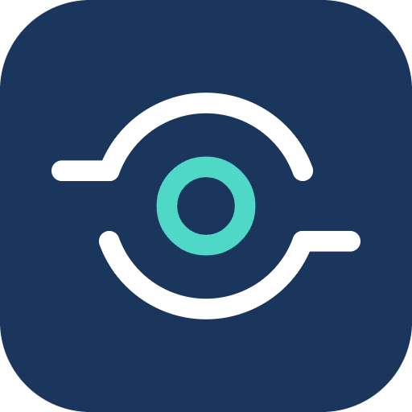

# IPRwise: Claude plugin



This plugin connects Claude to [IPRwise](https://www.iprwise.com) ([iprwise.com/ai](https://www.iprwise.com/ai)), the global network of IP attorneys. Claude writes the answer; IPRwise supplies checked reference data with its sources: country IP facts for 191 jurisdictions quoted from official sources, international filing routes, statutory deadline and official trademark fee calculators, the IPRwise attorney directory, open cross-border IP requests, IP office announcements, Nice Classification 2027 checks, and WIPO Madrid, Hague and PCT data.

For Google Antigravity, Gemini CLI, Qwen Code, OpenAI Codex, Cursor, VS Code / GitHub Copilot, Cline, Kiro, Windsurf, Zed and Goose, see the multi-client repository: [asimokat/iprwise-eklenti](https://github.com/asimokat/iprwise-eklenti).

**Türkçe:** [aşağıda](#türkçe)

## What is in the plugin

| Part | What it does |
|---|---|
| `iprwise` connector | Connects to `https://www.iprwise.com/mcp`. 25 read-only tools (below). |
| `foreign-associate` skill | How to choose and instruct an attorney in another country: check the country's rules, deadlines and official fees, shortlist on IPRwise, write the instruction letter. |
| `filing-strategy` skill | How to plan filings across several countries: Paris priority, Madrid, Hague, PCT and regional routes, statutory deadlines, official trademark fees, country rules and Nice 2027 wording. |
| `refusal-triage` skill | How to triage a WIPO Madrid provisional refusal or national office action: inspect the registration and refusal, compute the response deadline, check office refusal patterns and cut terms, verify POA/local-agent rules, shortlist counsel and draft a brief. |
| `ip-watch-and-leads` skill | How to audit a company's or competitor's Madrid and PCT portfolio (including non-use candidates) or run a daily practice digest of incoming refusals, renewals, domain gaps, watch matches and open tasks for an attorney's jurisdiction. |

## Tools

All 25 tools are read-only (`readOnlyHint: true`). None writes anything to IPRwise. Tools under **Member office and watch tools** follow the exact visibility rules of iprwise.com: only the office of the country in the signed-in member's IPRwise profile, showing the first 10 rows with the total for unverified members and the full list for verified members.

**Reference, directory and marketplace (7)**

| Tool | What it returns |
|---|---|
| `country_ip_facts` | Key IP facts for 191 jurisdictions: IP office, main law, trademark, patent, utility model and design terms, opposition and non-use cancellation periods, local agent rule, power of attorney formalities, filing language. Each fact has the official source link and a short verbatim quote from that source. |
| `filing_routes` | For up to 25 countries: Paris Convention, PCT, Madrid Protocol and Hague Agreement membership with effective dates, plus EUIPO, Benelux, EPO (member, extension, validation), EAPO, OAPI and ARIPO (Harare, Banjul). Flags accessions not yet in force. Source: WIPO Lex and the official member lists. |
| `find_attorneys` | 25,000+ IP attorneys and firms: IPRwise members whose identity and professional registration IPRwise checked come first, then directory records from public sources (such as the EPO list of professional representatives, EAPO and public business listings). Filters: practice, city. Each entry links to its iprwise.com profile. |
| `attorney_profile` | One public directory profile by its slug (from `find_attorneys`): name, firm, role, practice, city, country, website and whether it is a verified IPRwise member, with the profile link. Removed profiles are never returned. |
| `open_tasks` | Open cross-border IP work requests posted on IPRwise: NDA-safe public summary (jurisdiction, IP right, action, timeline) and direct link to `https://www.iprwise.com/tasks/<id>`. |
| `ip_news` | IPRwise IP Radar: official announcements of IP offices (fees, laws, accessions, practice, e-filing, decisions, events, warnings) with effective dates and source links. Summaries in nine languages. |
| `nice_2027_check` | Checks goods and services terms against the 2027 edition of the Nice Classification (NCL 13-2027): added, deleted, reworded or moved, with the new wording. |

**Deterministic calculators (2)** (from the same single fee table and office calendars as the website)

| Tool | What it returns |
|---|---|
| `ip_deadline` | Last day of a statutory period at 12 offices (USPTO, EPO, EUIPO, TÜRKPATENT, WIPO, UKIPO, DPMA, JPO, CNIPA, KIPO, CIPO, IP Australia): months added with the end-of-month rule, then weekends and official closure days skipped, citing the legal rule and calendar source. Covers Paris priority, PCT national phase, office action / refusal responses, renewal grace and custom periods. |
| `official_fees` | Official trademark filing fees of 13 offices and the WIPO Madrid route total in CHF (basic fee, individual or complementary fee per designated office including Art. 9sexies, supplementary class fee), each with its source page and tariff date. Attorney fees are not included. |

**WIPO Madrid, Hague and PCT data (11)**

| Tool | What it returns |
|---|---|
| `madrid_mark` | Looks up a single WIPO Madrid international registration by IRN with its refusal history, or searches Madrid registrations by mark name. |
| `madrid_refusals` | Open provisional refusals on Madrid registrations with running response deadlines: refusing office, total or partial, notification date, response deadline, holder, representative. Filterable by office, Nice class, office of origin and type. |
| `madrid_office_scorecard` | How an office treats Madrid designations: refusal counts and outcomes, time to first decision, median days to closure and refusal rates by Nice class. |
| `madrid_top_representatives` | Most active Madrid representatives (new international filings and subsequent designations) in the last 30 days, with their main clients. |
| `goods_services_terms` | Goods and services terms cut, objected to or restricted by offices in Madrid designations, by Nice class. |
| `competitor_filings` | Recent Madrid filings (last 60 days) and the Madrid portfolio of a company or brand, with designated countries. |
| `brand_expansions` | New international registrations and subsequent designations: brands designating new countries via Madrid. |
| `non_use_candidates` | Madrid registrations old enough for a non-use cancellation action in 17 jurisdictions, ranked, citing the statute. A candidate is not proof of non-use. |
| `hague_designs` | International designs (Hague System) designating an office: new (`recent`), expiring within 90 days (`expiring`), without a recorded representative (`unrepresented`), or refused (`refused`). |
| `pct_national_phase_leads` | PCT applications nearing their 30- or 31-month national phase entry deadline at a target office (from WIPO PATENTSCOPE gazettes). |
| `pct_applicant_tracker` | PCT filing portfolio and Madrid marks of a company, university or inventor, with top IPC and Nice classes, open refusals and recent filings. |

**Member office and watch tools (5)**

| Tool | What it returns |
|---|---|
| `domain_gaps` | Brands newly designated to the member's country via Madrid whose corresponding local country-code domain appears unregistered/open. |
| `madrid_renewals` | International registrations in the member's office nearing 10-year renewal (next 6 or 12 months) or in the 6-month renewal grace period. |
| `madrid_office_leads` | Six daily lists for the member's office: lapsed marks, 3-month transformation leads, open Paris priority window, US/Philippine declarations of use due, owner/representative changes, and foreign firms filing into the office. |
| `madrid_portfolio` | Madrid portfolio of a representative firm: mark count, open provisional refusals ordered by nearest deadline, upcoming renewals and use declarations due. |
| `mark_watch_matches` | Newly published Madrid marks matching the member's saved similar-mark watch list on iprwise.com, with opposition deadlines. Read-only; edit the watch list on the website. |

## Installation

### claude.ai and the Claude desktop app

1. **Customize → Plugins → Add → Add marketplace**: type `asimokat/iprwise-claude-eklenti`.
2. Install the **iprwise** plugin from the **Discover** list.
3. In the plugin's **Connectors** tab, connect. An iprwise.com page opens: sign in with your IPRwise account (Google, LinkedIn, Microsoft or e-mail) and click **Allow**.

Installing the plugin does not sign anyone in; each user connects with their own IPRwise account. A free account is enough.

### Claude Code

```bash
claude plugin marketplace add asimokat/iprwise-claude-eklenti
claude plugin install iprwise@iprwise
```

Then type `/mcp` in a session, choose `plugin:iprwise:iprwise` and sign in.

### ChatGPT

The same connector is published as a ChatGPT plugin: [IPRwise on ChatGPT](https://chatgpt.com/plugins/plugin_asdk_app_6add4fdcfe108191b262e938b47ad7a1). Open the page, click **Install**, and sign in with your IPRwise account when asked. Four workflow skills (`filing-strategy`, `foreign-associate`, `refusal-triage`, `ip-watch-and-leads`) and a `get-started` skill are bundled. ChatGPT may list fewer tools until OpenAI has reviewed the newest version.

### Other AI tools and IDEs

For Google Antigravity, Gemini CLI, Qwen Code, OpenAI Codex, Cursor, VS Code / GitHub Copilot, Cline, Kiro, Windsurf, Zed and Goose, install from [asimokat/iprwise-eklenti](https://github.com/asimokat/iprwise-eklenti) or see [iprwise.com/ai](https://www.iprwise.com/ai).

### Connector only (any MCP client)

- Endpoint: `https://www.iprwise.com/mcp` (Streamable HTTP, JSON responses)
- Authorization: OAuth 2.1 with sign-in by IPRwise account. Supports both Client ID Metadata Documents (CIMD) and Dynamic Client Registration (RFC 7591) at `https://www.iprwise.com/api/oauth/register`; public clients only (`token_endpoint_auth_method: none`); authorization code with PKCE `S256`; scopes `iprwise` and `offline_access`.
- Metadata: `https://www.iprwise.com/.well-known/oauth-protected-resource/mcp` and `https://www.iprwise.com/.well-known/oauth-authorization-server`
- Official MCP Registry name: `com.iprwise/mcp`
- Claude Code without the plugin: `claude mcp add --transport http --scope user iprwise https://www.iprwise.com/mcp`

Use the `www.` address exactly as written.

## What it sends and keeps

- The plugin connects only to `https://www.iprwise.com/mcp`. It contains no hooks, no local server and no programs.
- The text of your questions and tool arguments is not stored. For each tool call the server log keeps the tool name, the duration, the size of the answer, whether an error occurred, the client application's name and a shortened account identifier.
- Member tools use the country and verification status in your IPRwise profile to show the same lists you see on the website, and `mark_watch_matches` reads the watch list you saved on IPRwise. The connector cannot change your profile or watch list and cannot see your other private data, such as your messages, private task files or payment details.
- IPRwise keeps a daily call counter for each account (total calls, calls per tool, calls per client application) and deletes it 12 months after the day it covers.
- Codes and tokens are stored only as SHA-256 hashes. Authorization codes expire after 5 minutes, access tokens after 1 hour, refresh tokens after 30 days; expired records are deleted within 30 days. Application registrations are deleted 12 months after their last use.
- Limits: 300 tool calls a day per account; within that, up to 60 calls each for live search tools (`find_attorneys`, `competitor_filings`, `non_use_candidates`, `madrid_portfolio`, `pct_applicant_tracker`, `madrid_refusals`, `hague_designs`, `madrid_mark`). They reset at 00:00 UTC.
- Overview: https://www.iprwise.com/ai · Privacy policy (section 4, "AI assistants connected to your account"): https://www.iprwise.com/privacy · Terms: https://www.iprwise.com/terms

## Check the connection

Ask Claude: "Is Türkiye a member of the Madrid Protocol, and since when?" Claude should call `filing_routes` and answer: member since 1 January 1999.

The tools return reference information, not legal advice. Rules and fees change; confirm with a local attorney before acting.

## Türkçe

Bu eklenti Claude'u [IPRwise](https://www.iprwise.com)'a ([iprwise.com/ai](https://www.iprwise.com/ai) — dünya genelindeki fikri mülkiyet vekilleri ağı) bağlar. Cevabı Claude yazar; IPRwise kaynağıyla doğrulanmış veriyi sunar: 191 yargı çevresi için resmî kaynaktan birebir alıntılı ülke bilgileri, uluslararası başvuru yolları, tatil takvimli yasal süre ve resmî marka harcı hesaplayıcıları, 25.000+ kayıtlı IPRwise vekil rehberi, açık sınır ötesi iş talepleri (`open_tasks`), IP ofisi duyuruları, Nice 2027 değişiklikleri ile WIPO Madrid, Lahey ve PCT verileri (**25 salt okunur alet** ve **4 skill**: yabancı vekil seçimi/talimatı, çok ülkeli başvuru stratejisi, geçici ret analizi ve portföy/ofis izleme özeti).

- **Kurulum (claude.ai ve masaüstü):** Customize → Plugins → Add → Add marketplace → `asimokat/iprwise-claude-eklenti` → **iprwise** eklentisini kur → Connectors sekmesinde bağlan → açılan iprwise.com sayfasında IPRwise hesabınla gir ve **İzin ver**.
- **Claude Code:** `claude plugin marketplace add asimokat/iprwise-claude-eklenti` ve `claude plugin install iprwise@iprwise`, ardından `/mcp` menüsünden giriş yap.
- **ChatGPT:** aynı bağlayıcı ChatGPT eklentisi olarak yayında: [IPRwise on ChatGPT](https://chatgpt.com/plugins/plugin_asdk_app_6add4fdcfe108191b262e938b47ad7a1).
- **Diğer yapay zekâ araçları (Antigravity, Gemini CLI, Qwen Code, Codex, Cursor, VS Code / Copilot, Cline, Kiro, Windsurf, Zed, Goose):** çok araçlı evrensel eklenti deposu [asimokat/iprwise-eklenti](https://github.com/asimokat/iprwise-eklenti) ve genel bakış sayfası [iprwise.com/ai](https://www.iprwise.com/ai).
- **Ücretsiz hesap yeter.** Her kullanıcı kendi IPRwise hesabıyla bağlanır.
- **25 aletin tamamı yalnız okur (`readOnlyHint: true`);** IPRwise'a hiçbir şey yazmaz. Soru metni ve alet girdileri sunucuda kaydedilmez.
- **Üye aletleri** (`domain_gaps`, `madrid_renewals`, `madrid_office_leads`, `madrid_portfolio`, `mark_watch_matches`) sitedeki kuralla çalışır: üye yalnız profilindeki ülkenin ofisini görür; doğrulanmamış üye ilk 10 satırı ve toplamı, doğrulanmış üye tam listeyi görür.
- **Saklama:** günlük sayaç 12 ay sonra, süresi dolan bağlantı kayıtları 30 gün içinde silinir. Ayrıntı: [gizlilik metni, 4. bölüm](https://www.iprwise.com/kvkk).
- **Sınır:** hesap başına günde 300 çağrı (00:00 UTC'de sıfırlanır).

## License

MIT, see [LICENSE](LICENSE). The license covers the plugin files in this repository only; the IPRwise service and its data are subject to the [IPRwise terms](https://www.iprwise.com/terms).
