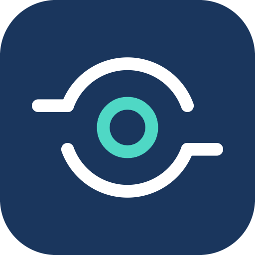

# IPRwise: Claude plugin



This plugin connects Claude to [IPRwise](https://www.iprwise.com), the global network of IP attorneys. Claude writes the answer; IPRwise supplies checked reference data with its sources: country IP facts quoted from official sources, international filing routes, the IPRwise attorney directory, IP office announcements and the Nice Classification 2027 changes.

**Türkçe:** [aşağıda](#türkçe)

## What is in the plugin

| Part | What it does |
|---|---|
| `iprwise` connector | Connects to `https://www.iprwise.com/mcp`. Five read-only tools (below). |
| `foreign-associate` skill | How to choose and instruct an attorney in another country: check the country's rules, shortlist on IPRwise, write the instruction letter. |
| `filing-strategy` skill | How to plan filings in several countries: Paris priority, Madrid, Hague, PCT and regional routes, country rules, Nice 2027 wording. |

## Tools

All five tools are read-only (`readOnlyHint: true`). None writes anything to IPRwise.

| Tool | What it returns |
|---|---|
| `country_ip_facts` | Key IP facts for one country: IP office, main law, trademark term, opposition period, non-use cancellation, patent and utility model terms, design protection, local agent requirement, power of attorney formalities, filing language. Each fact has the official source link and a short verbatim quote from that source. |
| `filing_routes` | For up to 25 countries: Paris Convention, PCT, Madrid Protocol and Hague Agreement membership with the date it took effect, plus EU, Benelux, EPO (member, extension, validation), EAPO, OAPI and ARIPO (Harare, Banjul). Flags accessions not yet in force. Source: WIPO Lex and the official member lists. |
| `find_attorneys` | IP attorneys and firms in a country: IPRwise members whose identity and professional registration IPRwise checked come first, then directory records from public sources (such as the EPO list of professional representatives, EAPO and public business listings). Filters: practice, city. Each entry links to its iprwise.com profile. |
| `ip_news` | IPRwise IP Radar: official announcements of IP offices (fees, laws, accessions, practice, e-filing, decisions, events, warnings) with effective dates and source links. Summaries in nine languages. |
| `nice_2027_check` | Checks goods and services terms against the 2027 version of the Nice Classification (NCL 13-2027): added, deleted, reworded or moved, with the new wording. |

## Installation

### claude.ai and the Claude desktop app

1. **Customize → Plugins → Add → Add marketplace**: type `asimokat/iprwise-claude-eklenti`.
2. Install the **iprwise** plugin from the **Discover** list.
3. In the plugin's **Connectors** tab, connect. An iprwise.com page opens: sign in with your IPRwise account (Google, LinkedIn, Microsoft or e-mail) and click **Allow**.

Installing the plugin does not sign anyone in; each user connects with their own IPRwise account. A free account is enough.

### Claude Code

```bash
claude plugin marketplace add asimokat/iprwise-claude-eklenti
claude plugin install iprwise@iprwise
```

Then type `/mcp` in a session, choose `plugin:iprwise:iprwise` and sign in.

### Connector only (any MCP client)

- Endpoint: `https://www.iprwise.com/mcp` (Streamable HTTP, JSON responses)
- Authorization: OAuth 2.1 with sign-in by IPRwise account. Dynamic Client Registration (RFC 7591) at `https://www.iprwise.com/api/oauth/register`; public clients only; authorization code with PKCE `S256`; scopes `iprwise` and `offline_access`.
- Metadata: `https://www.iprwise.com/.well-known/oauth-protected-resource/mcp` and `https://www.iprwise.com/.well-known/oauth-authorization-server`
- Claude Code without the plugin: `claude mcp add --transport http --scope user iprwise https://www.iprwise.com/mcp`

Use the `www.` address exactly as written.

## What it sends and keeps

- The plugin connects only to `https://www.iprwise.com/mcp`. It contains no hooks, no local server and no programs.
- The text of your questions and tool arguments is not stored. For each tool call the server log keeps the tool name, the duration, the size of the answer, whether an error occurred, the client application's name and a shortened account identifier.
- IPRwise keeps a daily call counter for each account (total calls, calls per tool, calls per client application) and deletes it 12 months after the day it covers.
- Codes and tokens are stored only as SHA-256 hashes. Authorization codes expire after 5 minutes, access tokens after 1 hour, refresh tokens after 30 days; expired records are deleted within 30 days. Application registrations are deleted 12 months after their last use.
- Limits: 300 tool calls a day per account, of which up to 60 `find_attorneys` calls. They reset at 00:00 UTC.
- Privacy policy (section 4, "AI assistants connected to your account"): https://www.iprwise.com/privacy · Terms: https://www.iprwise.com/terms

## Check the connection

Ask Claude: "Is Türkiye a member of the Madrid Protocol, and since when?" Claude should call `filing_routes` and answer: member since 1 January 1999.

The tools return reference information, not legal advice. Rules and fees change; confirm with a local attorney before acting.

## Türkçe

Bu eklenti Claude'u IPRwise'a (dünya genelindeki fikri mülkiyet vekilleri ağı) bağlar. Cevabı Claude yazar; IPRwise kaynağıyla doğrulanmış veriyi verir: resmî kaynaktan birebir alıntılı ülke bilgileri, uluslararası başvuru yolları, IPRwise vekil rehberi, IP ofisi duyuruları ve Nice 2027 değişiklikleri.

- **Kurulum (claude.ai ve masaüstü):** Customize → Plugins → Add → Add marketplace → `asimokat/iprwise-claude-eklenti` → **iprwise** eklentisini kur → Connectors sekmesinde bağlan → açılan iprwise.com sayfasında IPRwise hesabınla gir ve **İzin ver**.
- **Ücretsiz hesap yeter.** Her kullanıcı kendi hesabıyla bağlanır.
- **Aletler yalnız okur;** IPRwise'a hiçbir şey yazmaz. Soru metni saklanmaz.
- **Saklama:** günlük sayaç 12 ay sonra, süresi dolan bağlantı kayıtları 30 gün içinde silinir. Ayrıntı: [gizlilik metni, 4. bölüm](https://www.iprwise.com/kvkk).
- **Sınır:** hesap başına günde 300 çağrı (bunun en çok 60'ı vekil araması).

## License

MIT, see [LICENSE](LICENSE). The license covers the plugin files in this repository only; the IPRwise service and its data are subject to the [IPRwise terms](https://www.iprwise.com/terms).
